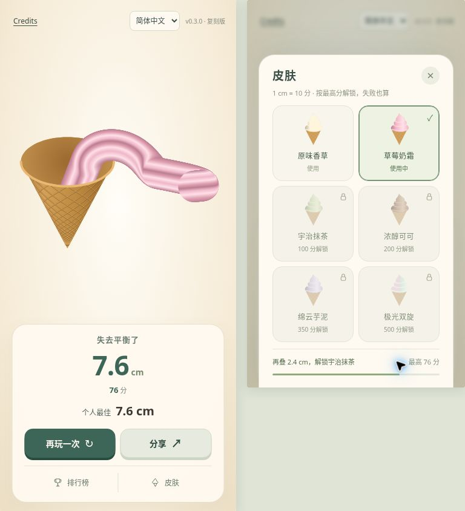

# 冰淇淋模拟器 · Soft Serve

本项目作者：kai。

**直接游玩：[GitHub Pages](https://kai-da-wang.github.io/softserve-game/)** · [联网主站](https://soft-serve-stack-kai.imjusttrying341.chatgpt.site)

一款竖屏冰淇淋小游戏。按住出奶油，自由拖动甜筒，松手完成；挑战叠高、解锁口味。

基于 [softserve.nog.cc](https://softserve.nog.cc/) 的玩法与界面独立实现，保留参考出处，未使用原站应用代码或远程素材。物理效果为独立近似实现。



## 玩法

- 屏幕下方按住出奶油，拖动直接移动甜筒，松手停止。
- 结束后拖动画面旋转查看成品，可分享图片或录屏。
- 每 1 cm = 10 分，成功与失败都按最高高度记录，意外中断不计分。
- 结算页底部进入排行榜与皮肤，游玩中保持简洁。

| 皮肤 | 最高分解锁 |
| --- | ---: |
| 原味香草 | 默认 |
| 草莓奶霜 | 50 |
| 宇治抹茶 | 100 |
| 浓醇可可 | 200 |
| 绵云芋泥 | 350 |
| 极光双旋 | 500 |

选择与进度会在本机保留。共享排行榜分总榜、每日榜：每人保留最高分，同分先达到者靠前；每日榜于北京时间 00:00 更新。云端根据操作记录重新模拟计分，不直接接受客户端声明的分数。

GitHub Pages 入口无需登录，游戏资源全部随站点加载；皮肤与最高分保存在当前浏览器。联网可读取共享排行榜；云端上传成绩需通过主站登录。不同入口的本机进度独立保存。

## 本地运行

需要 Node.js 22.13 或以上版本。

```sh
npm ci
npm run dev
```

完整应用使用 Vinext、Cloudflare Worker 与 D1（绑定名 `DB`）；数据库结构位于 `db/schema.ts`，迁移位于 `drizzle/`。云端登录身份由 Sites 的可信入口注入，公开仓库不包含原站点身份、密钥或玩家数据。克隆后需配置自己的部署与数据库，并通过可信认证入口提供身份；不要在外网直接信任浏览器自填的身份请求头。

只想试玩本机玩法，也可以静态运行：

```sh
python3 -m http.server 8080 --directory public
```

打开 `http://localhost:8080/game/`。静态模式保留游戏和本机皮肤进度，共享排行榜需要后端支持。

## 检查与构建

```sh
npm run check
npm run test:api
npx tsc --noEmit
npm run build
npm run build:pages
```

测试覆盖操作、平衡与洒落、30/60 FPS、几何与材质、解锁边界、北京时间换日、成绩复算，以及临时 Worker/D1 中的排行榜与权限逻辑；不会写入线上测试成绩。

手机界面已验证 390×844 和 360×640 两种尺寸。浏览器视觉验证使用 Canvas 兼容渲染，Three.js 的几何与颜色单独测试。

## 技术与出处

- Three.js r170（MIT，保留原许可）；程序生成甜筒、挤出口和奶油网格。
- WebGL2 不可用时自动使用 Canvas 兼容渲染。
- 中文、英语、日语、韩语；原生分享与录屏能力按浏览器支持启用。
- 玩法与界面参考：[softserve.nog.cc](https://softserve.nog.cc/)。

[English technical notes](README.en.md)
